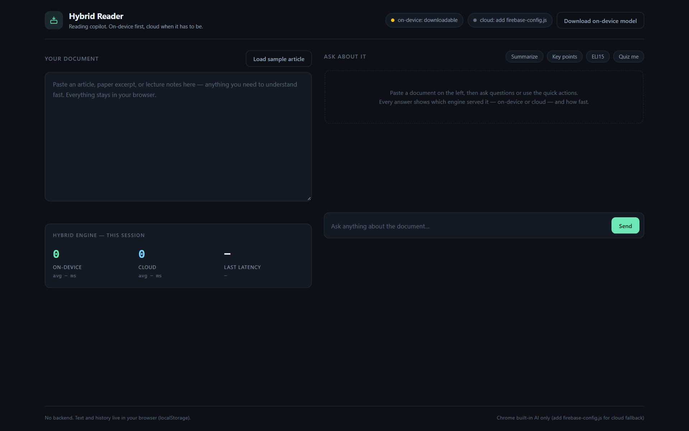
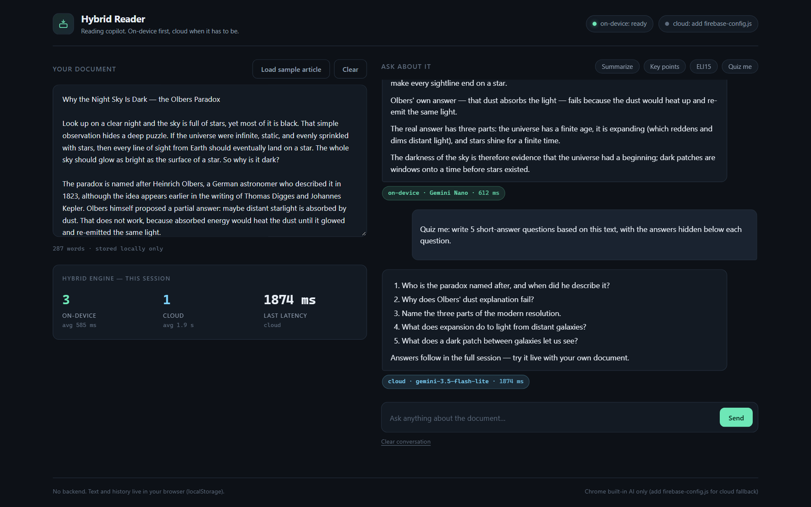
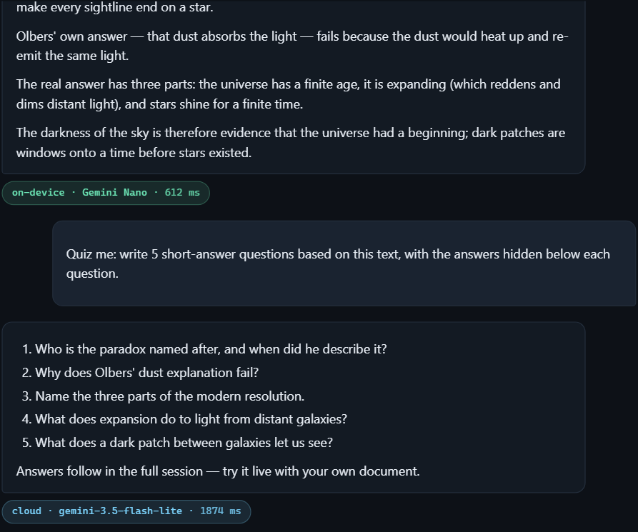
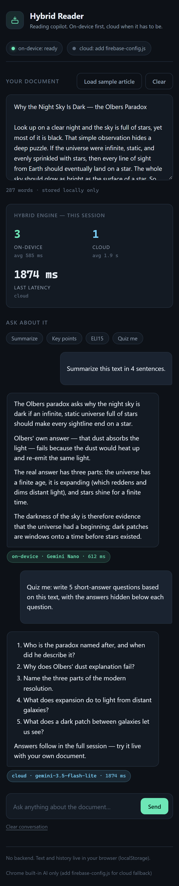

# Hybrid Reader

An offline-first reading copilot: paste any article or notes, ask questions, get summaries, key points, or a quiz — with every answer labeled by which engine served it, on-device Gemini Nano or cloud, and how fast.

Built for the **#BuildHybridAI** hackathon (Firebase AI Logic, Web/Chrome track). No backend, no accounts; everything lives in your browser.



## 60-second tour

1. Open the app. The header shows two engine pills: the on-device model (Chrome built-in Gemini Nano) and the cloud fallback (Firebase AI Logic). Paste a document or hit **Load sample article**.
2. Ask anything, or use the quick actions (Summarize / Key points / ELI15 / Quiz me).
3. Every AI answer carries a **hybrid badge**: `on-device · Gemini Nano · 612 ms` or `cloud · gemini-3.5-flash-lite · 1874 ms`. This is measured per request, not estimated.
4. The **stats card** keeps session score: responses per path and average latency of each — the visible proof of hybrid inference.
5. If Gemini Nano isn't downloaded yet, the app offers a one-click download with live progress and uses the cloud model until the download finishes. History and stats persist across reloads via localStorage.





## Setup

The app runs as-is in Chrome 139+ with zero configuration (on-device path only). To enable the cloud fallback via Firebase AI Logic:

1. Go to [console.firebase.google.com](https://console.firebase.google.com) and sign in with your Google account. Click **Add project**, give it a name (e.g. `hybrid-reader`), and continue with the defaults (no Google Analytics needed). The free **Spark** plan is enough.
2. In the project, click the **Web** icon (`</>`) to register a web app, give it a nickname, and click **Register app**. Firebase shows a `firebaseConfig` object.
3. In this repo, copy the example config:
   ```
   cp firebase-config.example.js firebase-config.js
   ```
   and paste your config values into it (`apiKey`, `authDomain`, `projectId`, `storageBucket`, `messagingSenderId`, `appId`). This file is gitignored — never commit it.
4. In the Firebase console, open **AI Logic** in the left menu (or **Build > AI Logic**) and enable it for your project (this uses the Gemini Developer API backend on the free tier — no billing card required).
5. Start the app (`npm start`, or `node server.js`, or `python -m http.server 8000`) and open `http://localhost:8000`. The cloud pill in the header should turn blue and show the connected model.

On first run Chrome may report the on-device model as `downloadable`; click **Download on-device model** in the header. The download is several hundred MB and takes a few minutes; progress is shown live.

## Run

```
npm start          # node server.js  → http://localhost:8000
# or
python -m http.server 8000
```

Any static file server works. Opening `index.html` directly from disk does not (ES modules require HTTP).

## Architecture

```
index.html ── js/app.js ─────────── UI, chat, badges, stats, persistence
     │              │
     │              └─ js/store.js ─ localStorage (doc, messages, stats)
     │
     └─ js/engine.js ───────────── THE ONLY place AI is called
            │
            ├─ js/firebase-backend.js  (loaded only if firebase-config.js exists)
            │     firebase/ai: getAI(app, {backend: new GoogleAIBackend()})
            │     device  → getGenerativeModel(ai, {mode: InferenceMode.ONLY_ON_DEVICE})
            │     cloud   → getGenerativeModel(ai, {mode: InferenceMode.ONLY_IN_CLOUD, model})
            │     download→ model.initializeDeviceModel(progress)
            │
            └─ Chrome native LanguageModel Prompt API (fallback, no config needed)
```

Request flow per prompt: if `LanguageModel.availability() === "available"`, call the
on-device model and measure latency; otherwise call the cloud model. Because the path
is chosen explicitly, the badge reflects the engine that actually served the response.
If neither path is available, the UI shows a clear message instead of failing.

## Demo video

`demo/demo-video.mp4` (~1:56, 1080p) is generated by `demo/generate_demo.py`, which
screenshots the real running app with Playwright, narrates it with edge-tts
(`en-IN-PrabhatNeural`), and muxes with ffmpeg. Regenerate with:

```
node server.js 8031 &
python demo/generate_demo.py
```

Note: for recording, `?demo=1` seeds a sample session (the recording machine has no
cloud key). The badges, stats, and UI are the real app; only the response contents are
seeded placeholders.

## Honest limits

- On-device Gemini Nano is **single-turn text only** — no multi-turn chat memory on that path (the document is re-sent as context each time), no tools, no images/PDFs. Chrome desktop 139+ required; on other browsers the app degrades to cloud-only or shows a clear "no AI available" state.
- The cloud path needs a Firebase project (free tier) and network; responses leave the device on that path, which is exactly what the badges disclose.
- The Chrome built-in AI model is a one-time large download and can take minutes on slow connections.
- Cloud model IDs change fast; `cloudModelId` in `firebase-config.js` is a single place to update it.
- History is capped at the last 100 messages and stored unencrypted in localStorage — fine for notes, not for secrets.

## Live demo

**https://abhinavshukla152005-beep.github.io/hybrid-reader/** — GitHub Pages build of this repo.
It runs the on-device path only (no `firebase-config.js` is published), so in Chrome 139+ you get
Gemini Nano directly; on other browsers it shows the clear "no AI available" state. For the full
hybrid experience with the cloud fallback, run locally with your own Firebase config (5 steps above).

## Repo

https://github.com/abhinavshukla152005-beep/hybrid-reader
